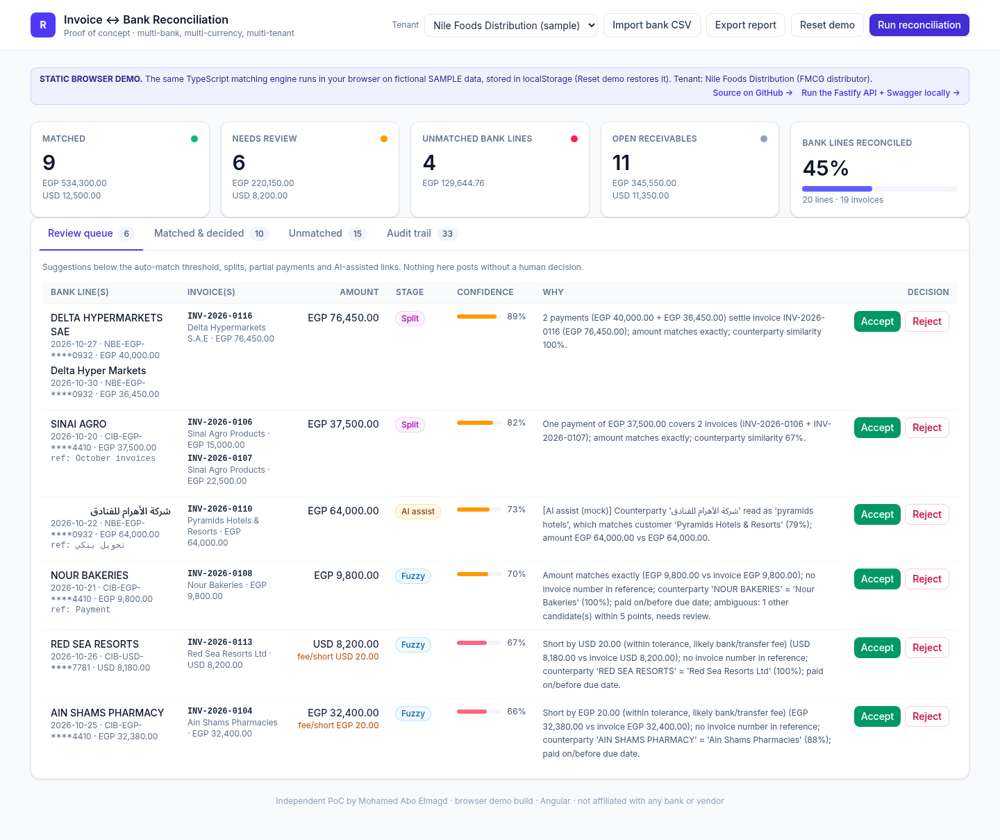
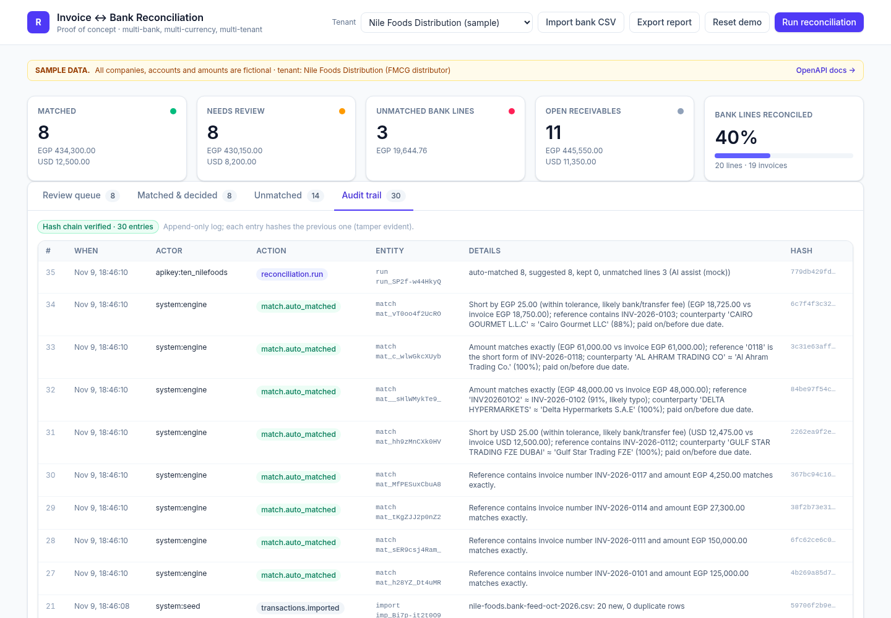
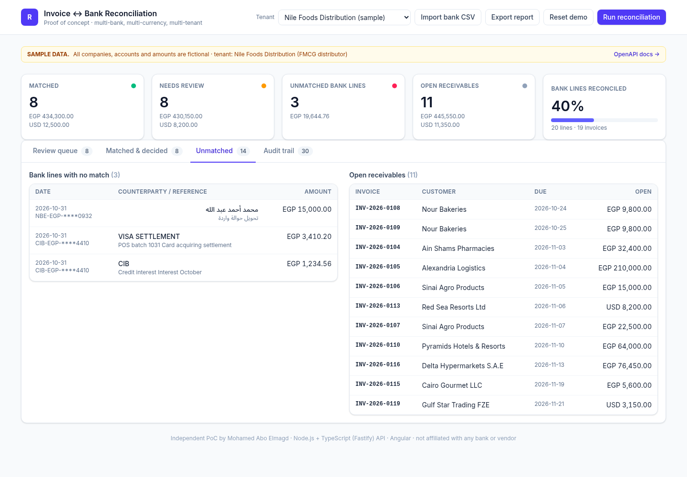
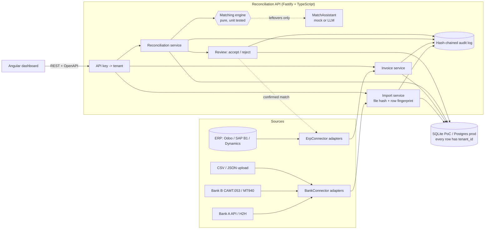

# Invoice-to-Bank Reconciliation PoC

**Live demo: https://reconciliation-engine-poc.web.app** (static browser build, fictional sample data)

An independent proof of concept by Mohamed Abo Elmagd for B2B finance / FinTech teams: matching incoming
bank credits to open invoices, explaining every decision, and leaving a tamper-evident audit trail.
Multi-tenant Node.js/TypeScript API + Angular dashboard.
**All data in `backend/sample-data/` is fictional.**



| Audit trail (hash chain verified) | Unmatched lines and open receivables |
|---|---|
|  |  |

### About the live demo
Firebase Hosting is static, so the live site is a **browser demo build** of the same Angular app: the
matching engine and import helpers are imported directly from `backend/src` and run in your browser, with a
per-tenant store in `localStorage` (SHA-256 hash-chained audit log via Web Crypto). Run reconciliation,
accept/reject, import a CSV (try re-importing `backend/sample-data/nile-foods.bank-feed-oct-2026.csv` to see
idempotency), export the report, and switch tenants. **Reset demo** restores the sample data.
The full Fastify API with Swagger UI is the real backend; run it locally with one command (see [Run it](#run-it)).

## The problem

A finance team in Egypt/MENA receives money through several banks (CIB, NBE, QNB...), in EGP and USD,
via InstaPay, ACH, cheques and SWIFT. The ERP holds the open invoices. Matching the two by hand is slow
because real bank lines are messy:

| Real-world mess | Example in the sample feed |
|---|---|
| Typos in the reference | `INV-2026-01O2` (letter O) for `INV-2026-0102` |
| Short or partial reference | `PMT INV 2026 0118` |
| Fees deducted by the bank | USD 12,475 received for a USD 12,500 invoice |
| No reference at all | `AIN SHAMS PHARMACY`, amount short by EGP 20 |
| One transfer, several invoices | EGP 37,500 = INV-0106 + INV-0107 |
| Several transfers, one invoice | EGP 40,000 + 36,450 = INV-0116 |
| Instalments quoting the invoice | `دفعة أولى من فاتورة INV-2026-0105`, then `... final` |
| Arabic vs English names | `شركة الأهرام للفنادق` paying `Pyramids Hotels & Resorts` |
| Arabic-Indic digits | `INV-٢٠٢٦-٠١١١` |
| Lines that are not customer payments | interest credit, card settlement, unknown individual |

Goal: auto-post only what is certain, queue the rest for a human with a clear reason and a confidence
score, never post the same money twice, and record who decided what.

## What is in the box

- **Matching engine** (`backend/src/engine`): pure TypeScript, no I/O, 20 unit tests (+7 API end-to-end tests).
- **API** (`backend/src`): Node.js 22+ / TypeScript / Fastify 5, OpenAPI 3 + Swagger UI at `/docs`,
  multi-tenant by API key, SQLite with versioned migrations, idempotent imports, hash-chained audit log.
- **Dashboard** (`frontend`): Angular 22 (standalone components, signals, zoneless) + Tailwind CSS v4:
  summary cards, review queue with accept/reject, unmatched bank lines and open receivables, audit trail,
  CSV import and report export, tenant switcher.
- **Sample data**: two fictional tenants (an FMCG distributor and a textile exporter).

## Run it

Requirements: Node.js >= 22.13 (uses the built-in `node:sqlite`, no native modules).

```bash
npm start          # installs, builds API + dashboard, starts http://localhost:3000
```

- Dashboard: http://localhost:3000/  (click **Run reconciliation**)
- API docs:  http://localhost:3000/docs
- Demo API keys: `demo_nilefoods_key`, `demo_lotustextiles_key`

Other scripts: `npm test` (all backend tests), `npm run dev:api` + `npm run dev:web` (watch mode, dashboard on
:4200 with proxy), `npm run seed` (reset sample data), `npm run screenshot` (headless Chrome capture),
`npm run build:demo` (static browser build into `frontend/dist/demo/browser`), `npm run deploy:demo`
(Firebase Hosting target `demo`), `npm run smoke:demo -- <url>` (headless end-to-end check of the demo).

### Try the API with curl

```bash
K='x-api-key: demo_nilefoods_key'; B=http://localhost:3000/api/v1
curl -s -XPOST $B/reconciliation/runs -H "$K" -H 'x-actor: Mohamed'
curl -s "$B/matches?status=suggested" -H "$K"
curl -s -XPOST $B/matches/<id>/accept -H "$K" -H 'content-type: application/json' -d '{"note":"remittance checked"}'
curl -s "$B/audit-log?limit=5" -H "$K"; curl -s $B/audit-log/verify -H "$K"
curl -s -XPOST "$B/transactions/import?filename=feed.csv" -H "$K" -H 'content-type: text/csv' --data-binary @backend/sample-data/nile-foods.bank-feed-oct-2026.csv
curl -s $B/reports/reconciliation.csv -H "$K" -o report.csv
```

## Architecture



```
backend/
  src/engine/        pipeline.ts (stages), text.ts (Arabic/Latin normalisation, similarity), assist.ts, types.ts
  src/services/      reconciliation.ts (use cases), audit.ts, csv.ts, seed.ts
  src/db/            migrations.ts, database.ts
  src/routes/        api.ts (endpoints), schemas.ts (TypeBox -> JSON Schema -> OpenAPI)
  src/connectors/    BankConnector / ErpConnector ports
  test/              engine.test.ts (unit), api.test.ts (end-to-end via fastify.inject)
frontend/src/app/    backend.ts (Backend interface), api.service.ts (HTTP backend), demo/browser-backend.ts
                     (static demo: same engine + localStorage store), components/*
docs/adr/            architecture decision records
```

## Matching pipeline

Each stage only sees what earlier stages left, so cheap and certain rules run first and the uncertain ones
only touch the long tail. Money is integer minor units throughout. Every proposal carries `status`
(`matched` = auto-posted, `suggested` = needs a human), `confidence` 0..1, `differenceMinor` (fees) and a
human-readable `reason`.

| # | Stage | Rule | Result |
|---|---|---|---|
| 1 | **exact** | A reference token equals the normalised invoice number (case, punctuation and Arabic-Indic digits normalised) and the amount equals the open amount. Also handles one transfer quoting several invoice numbers. | `matched`, 1.00 |
| 2 | **fuzzy** | Same currency, amount within tolerance (max of 1% or 30.00, configurable), booking date within [issue - 7d, due + 60d], and either reference similarity (Levenshtein, short-form suffix) or counterparty similarity (Arabic normalisation + legal-form stopwords + bigram/token scoring). Weighted score: amount 35%, reference 30%, name 25%, date 10%. Greedy one-to-one assignment; if a rival candidate is within 5 points, it is flagged ambiguous. | `matched` if >= 0.90 and not ambiguous, else `suggested` |
| 3a | **partial** | Strong reference (>= 85%) but the payment covers only part of the open amount; also the final instalment that closes a partially paid invoice. | `suggested` |
| 3b | **split** | Subset-sum (<= 4 items) for one payment -> many invoices of the same customer, and many payments -> one invoice. | `suggested` |
| 4 | **assist** | Pluggable `MatchAssistant` sees leftovers only. Default `MockAssistant` is deterministic and offline (Arabic glossary + transliteration to match Arabic payers to English customer names). `MATCH_ASSISTANT=openai` plugs in any OpenAI-compatible endpoint. Output is treated as untrusted: ids, currency, amounts and rejected pairs are re-validated, status is forced to `suggested`, confidence capped at 0.80. | `suggested` |

Sample result on the Nile Foods feed (20 lines, 19 invoices): 8 auto-matched (4 exact, 4 fuzzy incl. typo and
fee cases), 8 suggestions (2 partial, 2 split, 1 AI-assist, 3 fuzzy), 3 bank lines correctly left unmatched
(interest, card settlement, unknown individual).

**Idempotency and re-runs**
- Import: the whole payload is hashed (or an `Idempotency-Key` header is used). Re-sending returns the first
  result with `replayed: true`. Each line also gets a fingerprint (bank account + bank transaction id, or a
  content hash) with a unique index, so overlapping statements never create duplicates.
- Reconciliation: confirmed matches are never touched; pending suggestions are recomputed and unchanged ones keep
  their id; pairs a human rejected are never proposed again. Running twice gives the same state.
- Accept re-validates against current state (no transaction used twice, no invoice over-allocated) inside a
  transaction; a second accept returns `409`.

## Multi-tenancy, audit and security notes

- **Tenant isolation**: every table has `tenant_id`, every query filters on it, and the tenant comes only from
  the API key (stored as SHA-256, never in plain text). Cross-tenant reads return 404 (tested).
  Production: Postgres Row-Level Security as a second line of defence (ADR-0002).
- **Audit log**: append-only (DB triggers block UPDATE/DELETE), one entry for every import, invoice change,
  auto-match, accept, reject and run, with actor, reason and allocations. Entries are hash-chained per tenant;
  `GET /audit-log/verify` recomputes the chain to detect tampering.
- **AI safety**: the model never auto-posts, only sees the minimal fields of leftover rows, and its output is
  validated like any external input.
- **Input validation**: JSON Schema on every route (TypeBox), ISO dates and currencies, decimal-string amounts
  parsed without floating point, all-or-nothing imports with row-level errors, 10 MB body limit.
- Basic security headers; CORS limited to localhost in the PoC.
- PoC shortcuts (see next steps): demo keys are public, reviewer identity comes from an `x-actor` header.

## Plugging in real banks and ERPs

`backend/src/connectors/types.ts` defines the ports:

```ts
interface BankConnector { fetchTransactions({ tenantId, accountRef, cursor }) -> { rows, nextCursor } }
interface ErpConnector  { fetchOpenInvoices({ tenantId, since }); postPayment({ matchId, invoiceExternalRefs, amountMinor, feeMinor, ... }) }
```

- A bank adapter (Open Banking API, host-to-host SFTP with MT940 / CAMT.053, or an aggregator) maps lines to
  `TxRowInput` and calls the same import service, so fingerprints keep it idempotent on retries. A scheduler or
  webhook drives `fetchTransactions` with a cursor per account.
- An ERP adapter syncs open invoices (by `externalRef`) and, on `match.accepted` / `match.auto_matched`, posts a
  customer receipt plus a bank-charges line for `differenceMinor`, idempotent on `matchId` (outbox pattern).
- The engine and the public API do not change when a new bank or ERP is added.

## Stack choices

- **Fastify** over NestJS to keep the PoC light and the request path obvious; TypeBox schemas give typed
  handlers and the OpenAPI document from one source. The same layering (routes -> services -> pure engine)
  maps 1:1 onto NestJS modules if the team prefers it.
- **SQLite via `node:sqlite`** so it runs with one command and zero native builds; plain SQL migrations are
  portable to Postgres (ADR-0001).
- **Two backends behind one interface** in the dashboard: `HttpBackend` (Fastify API) and `BrowserBackend`
  (static demo). The build configuration `demo` swaps the environment file; the engine code is shared, not copied.
- **Angular** for the PoC because it is my strongest UI stack; the dashboard talks only to the documented REST
  API, so a production front end in **React** (if a team already uses it) is a straight port.

## Next steps for production

1. Postgres + RLS, migrations in CI (e.g. node-pg-migrate / Prisma Migrate), read replicas for reporting.
2. Auth: OAuth2 client credentials for machine clients, OIDC/SSO for users, RBAC (preparer vs approver,
   four-eyes rule above an amount threshold), per-key scopes and rotation, rate limiting.
3. Real connectors: CAMT.053/MT940 parsers, bank APIs, ERP adapters with an outbox + retries + dead-letter queue.
4. Async runs: queue-based workers (BullMQ / SQS) per tenant, incremental matching on each new line, webhooks
   (`match.created`, `match.accepted`) for partners.
5. Engine: per-tenant learned rules (remember payer -> customer aliases after each accept), FX handling for
   cross-currency receipts, withholding-tax rules, configurable tolerances per tenant / bank, evaluation set
   with precision/recall tracked in CI.
6. LLM: provider abstraction already in place; add PII redaction, prompt/response logging to the audit trail,
   cost and latency budgets, offline evaluation before enabling per tenant.
7. Ops: Docker image + IaC, OpenTelemetry tracing, structured logs, SLOs, backups/PITR, audit log export to
   WORM storage, data residency for regulated customers.
8. Front end: React + design system, role-aware views, bulk accept, keyboard-driven review.

## Decision records

- [ADR-0001: Pure matching engine with staged pipeline](docs/adr/0001-pure-staged-matching-engine.md)
- [ADR-0002: Tenant isolation by API key and tenant_id on every row](docs/adr/0002-multi-tenancy.md)
- [ADR-0003: AI assist only on leftovers, never auto-posting](docs/adr/0003-ai-assist-guardrails.md)
